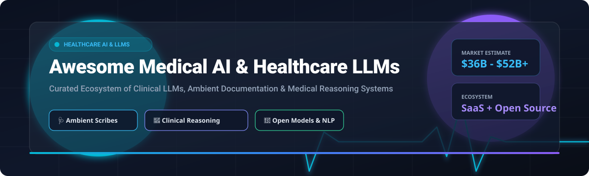

<div align="center">



# 🩺 Awesome Medical AI & Healthcare LLMs 🤖

<p align="center">
  <a href="https://github.com/ishandutta2007/Awesome-Awesome-Awesome"></a>
  <a href="https://discord.gg/jc4xtF58Ve"></a>
  <a href="https://github.com/ishandutta2007/Awesome-Medical-AI-Healthcare-LLMS/stargazers"></a>
  <a href="https://github.com/ishandutta2007/Awesome-Medical-AI-Healthcare-LLMS/network/members"></a>
  <a href="https://github.com/ishandutta2007"></a>
</p>

**A Curated Directory of SaaS Solutions, Ambient Clinical Scribes, Medical Reasoning Foundation Models & Open-Source Healthcare LLMs** 🌟

*Designed for Physician Builders, Clinical Informaticists, Health-Tech Founders, and AI Researchers.* 🔬

</div>

---

## 📑 Table of Contents
- [🌐 Sector Overview & Market Dynamics](#-sector-overview--market-dynamics)
- [🏥 Top SaaS & Hosted Enterprise Platforms](#-top-saas--hosted-enterprise-platforms)
- [💻 Open-Source Healthcare LLMs & Clinical NLP](#-open-source-healthcare-llms--clinical-nlp)
- [🏗️ Recommended Architecture for Custom Clinical AI](#️-recommended-architecture-for-custom-clinical-ai)
- [🤝 How to Contribute](#-how-to-contribute)
- [💖 Support & Sponsorship](#-support--sponsorship)
- [📊 Star History](#-star-history)
- [⚖️ Disclaimer](#️-disclaimer)

---

## 🌐 Sector Overview & Market Dynamics

The global healthcare artificial intelligence and clinical LLM market is estimated at **$36.8 billion to $52.2 billion in 2026**, growing at a rapid CAGR of over 35% as health systems urgently deploy AI to counteract clinician burnout and administrative overload. The sector is **moderately fragmented yet increasingly consolidating around EHR-integrated category champions**—while giants like Microsoft Nuance, Abridge, and Hippocratic AI dominate hospital enterprise contracts, nimble specialists (such as Heidi Health and Glass Health) maintain strong footholds among independent clinicians and specialty clinics.

---

## 🏥 Top SaaS & Hosted Enterprise Platforms

*Ranked in descending order of company size (Valuation / Market Capitalization).*

| Product | Valuation / Scale | Primary Use Case & Capabilities | Specific Starting Tier Pricing | Free Tier / Trial Limit |
| :--- | :--- | :--- | :--- | :--- |
| **[Nuance DAX Copilot](https://www.microsoft.com/en-us/health-solutions/clinical-workflow/dax-copilot)** | **$19.7B** *(Microsoft subsidiary; parent $3.1T)* | Enterprise ambient clinical scribe embedded in Epic and Microsoft Cloud for Healthcare | **$369 / clinician / month** *(annual agreement)* | **14-day free trial** via authorized medical reseller networks; enterprise pilots require formal scoping |
| **[Abridge](https://www.abridge.com/)** | **$5.3B** *(Series E unicorn)* | Conversational AI scribe converting dialogue into structured clinical notes and ICD/CPT coding | **~$208 / clinician / month** *($2,500/year enterprise base license)* | **No free tier or trial** *(enterprise sales rollout, EHR BAA, and institutional demo only)* |
| **[Hippocratic AI](https://hippocraticai.com/)** | **$3.5B** *(Series C unicorn)* | Patient-facing voice AI agents for care coordination, intake, triage, and chronic illness follow-up | **$9.00 / active agent hour** *(contracted institutional usage base)* | **No free tier or trial** *(gated sales motion requiring institutional pilot agreement)* |
| **[Ambience Healthcare](https://www.ambiencehealthcare.com/)** | **$1.1B** *(Series C unicorn)* | Enterprise clinical operating system covering AutoScribe ambient notes, CDI, and referrals | **$250 / clinician / month** *(starter AutoScribe module; outcome-based contract)* | **No free tier or trial** *(direct enterprise EHR integration demo only)* |
| **[Heidi Health](https://www.heidihealth.com/)** | **$900M** *(Series C)* | Cross-specialty ambient AI scribe, medical dictation, and evidence retrieval platform | **$45 / clinician / month** *(Scribe Plus monthly tier)* | **Free Forever Plan** *(unlimited ambient transcription, core templates, and 10 Pro AI actions/month)* |
| **[Suki AI](https://www.suki.ai/)** | **$500M+** *(Series E)* | Voice assistant and ambient documentation assistant with bidirectional EHR syncing | **$299 / user / month** *(Suki Compose tier)* | **No permanent free tier** *(custom 14 to 30-day organizational pilot upon sales qualification)* |
| **[Corti](https://www.corti.ai/)** | **$260M+** *(Series B)* | Clinical-grade AI co-pilot for emergency dispatch triage, patient consultations, and medical coding | **$0.02 / audio minute processed** *(Developer API starting rate)* | **14-day free trial** for API platform access with test audio credits |
| **[DeepScribe](https://www.deepscribe.ai/)** | **$200M** *(Series A)* | Ambient clinical AI scribe tailored specifically for complex specialties including oncology | **$250 / provider / month** *(base ambient documentation license)* | **No free tier** *(personalized clinical demo and multi-week system trial upon consultation)* |
| **[Glass Health](https://glass.health/)** | **$6M+** *(Seed / YC)* | AI-powered clinical decision support, differential diagnosis builder, and clinical notebook | **$20 / month** *(Starter clinician tier; Pro at $90/month)* | **Free Tier Available** *(Free for verified U.S. NPI clinicians; basic query limits for non-verified users)* |

---

## 💻 Open-Source Healthcare LLMs & Clinical NLP

*Ranked in descending order of GitHub community stars. Each star badge links directly to that repository's stargazer network.* 🌟

| Project | Stars | Focus & Description | Tech Stack / Architecture |
| :--- | :--- | :--- | :--- |
| **[MONAI](https://github.com/Project-MONAI/MONAI)** | [](https://github.com/Project-MONAI/MONAI/stargazers) | PyTorch-based framework for deep learning in healthcare imaging and clinical multimodal workflows | PyTorch, CUDA, Python |
| **[MedicalGPT](https://github.com/shibing624/MedicalGPT)** | [](https://github.com/shibing624/MedicalGPT/stargazers) | Full pipeline training framework for clinical LLMs supporting Pre-training, SFT, RLHF, DPO, and GRPO | PyTorch, Hugging Face, DeepSpeed |
| **[OpenMed](https://github.com/maziyarpanahi/openmed)** | [](https://github.com/maziyarpanahi/openmed/stargazers) | Local-first clinical NER, HIPAA PII de-identification, and inference suite with 2,200+ medical models | Python, MLX, Apache-2.0, ONNX |
| **[Huatuo (BenCao)](https://github.com/SCIR-HI/Huatuo-Llama-Med-Chinese)** | [](https://github.com/SCIR-HI/Huatuo-Llama-Med-Chinese/stargazers) | Instruction-tuned large language models fine-tuned with verified clinical medical knowledge graphs | LLaMA, LoRA, Python |
| **[Spark NLP](https://github.com/JohnSnowLabs/spark-nlp)** | [](https://github.com/JohnSnowLabs/spark-nlp/stargazers) | Enterprise-grade NLP library with comprehensive biomedical NER, assertion status, and relation extraction | Java, Scala, Apache Spark, Python |
| **[ChatDoctor](https://github.com/Kent0n-Li/ChatDoctor)** | [](https://github.com/Kent0n-Li/ChatDoctor/stargazers) | Medical chat assistant fine-tuned on physician-patient consultations with disease database grounding | LLaMA, PyTorch, Python |
| **[ClinicalBERT](https://github.com/EmilyAlsentzer/clinicalBERT)** | [](https://github.com/EmilyAlsentzer/clinicalBERT/stargazers) | Foundational clinical BERT embeddings pre-trained on MIMIC-III EHR notes for clinical prediction | PyTorch, BERT, Transformers |
| **[MedSpaCy](https://github.com/medspacy/medspacy)** | [](https://github.com/medspacy/medspacy/stargazers) | Modular clinical NLP library built on spaCy for sectionizer detection, context assertion, and clinical entities | spaCy, Python, Cython |
| **[MedCAT](https://github.com/CogStack/MedCAT)** | [](https://github.com/CogStack/MedCAT/stargazers) | Medical Concept Annotation Tool for extracting and linking text to SNOMED CT and UMLS ontologies | Python, spaCy, PyTorch |
| **[HuatuoGPT-II](https://github.com/FreedomIntelligence/HuatuoGPT-II)** | [](https://github.com/FreedomIntelligence/HuatuoGPT-II/stargazers) | One-stage training framework for medical domain adaptation of open foundation LLMs | PyTorch, DeepSpeed, Transformers |
| **[NegBio](https://github.com/ncbi-nlp/NegBio)** | [](https://github.com/ncbi-nlp/NegBio/stargazers) | High-performance clinical NLP system for negation and uncertainty detection in radiology reports | Python, Universal Dependencies |
| **[cTAKES](https://github.com/apache/ctakes)** | [](https://github.com/apache/ctakes/stargazers) | Apache clinical Text Analysis and Knowledge Extraction System for processing electronic health records | Java, Apache UIMA |
| **[FHIR-PYrate](https://github.com/UMEssen/fhir-pyrate)** | [](https://github.com/UMEssen/fhir-pyrate/stargazers) | Python library to query FHIR servers, extract clinical resources into DataFrames, and link DICOM studies | Python, FHIR, pandas |
| **[BioMistral](https://github.com/BioMistral/BioMistral)** | [](https://github.com/BioMistral/BioMistral/stargazers) | Suite of open-source biomedical foundation LLMs based on Mistral, fine-tuned on PubMed Central | Mistral, Transformers, PyTorch |
| **[MedTagger](https://github.com/OHNLP/MedTagger)** | [](https://github.com/OHNLP/MedTagger/stargazers) | Mayo Clinic lightweight clinical NLP indexing and concept extraction engine | Java, Apache UIMA |
| **[MetaMapLite](https://github.com/lhncbc/metamaplite)** | [](https://github.com/lhncbc/metamaplite/stargazers) | National Library of Medicine (NLM) near real-time named-entity recognizer for biomedical text | Java, UMLS Metathesaurus |
| **[HuatuoGPT-3](https://github.com/FreedomIntelligence/HuatuoGPT-3)** | [](https://github.com/FreedomIntelligence/HuatuoGPT-3/stargazers) | Thinking-mode medical reasoning LLM series trained via RL-only domain adaptation from base models | PyTorch, DeepSpeed |
| **[DocuScribe AI](https://github.com/abh2050/docu_scribe_ai)** | [](https://github.com/abh2050/docu_scribe_ai/stargazers) | Agentic ambient clinical documentation pipeline converting consultations into SOAP notes & FHIR JSON | Python, LangChain, Whisper |

---

## 🏗️ Recommended Architecture for Custom Clinical AI

```
┌────────────────────────────────────────────────────────┐
│             Ambient Audio / Clinical Intake            │
└───────────────────────────┬────────────────────────────┘
                            │
                            ▼
┌────────────────────────────────────────────────────────┐
│   Speech-to-Text & Diarization (Whisper / FasterWhisper)│
└───────────────────────────┬────────────────────────────┘
                            │
                            ▼
┌────────────────────────────────────────────────────────┐
│     Medical Entity & Concept Linking (MedCAT / MedSpaCy)│
│     - SNOMED-CT / ICD-10 / UMLS / Negation (NegBio)    │
└───────────────────────────┬────────────────────────────┘
                            │
                            ▼
┌────────────────────────────────────────────────────────┐
│    Reasoning & SOAP Generation (HuatuoGPT / OpenMed)   │
│    - Grounded differential diagnosis & clinical plans  │
└───────────────────────────┬────────────────────────────┘
                            │
                            ▼
┌────────────────────────────────────────────────────────┐
│       EHR Interoperability & Output (FHIR-PYrate)      │
│       - HL7 / FHIR Bundles / Structured Clinical Notes │
└────────────────────────────────────────────────────────┘
```

---

## 🤝 How to Contribute

Contributions are warmly welcomed! Please help expand this ecosystem:

1. 🍴 **Fork** this repository.
2. 🌿 Create a feature branch: `git checkout -b feature/new-healthcare-tool`
3. 📝 Add your entry ensuring:
   - Factual pricing and free-tier specifics (no vague placeholders).
   - Valid GitHub repository link with updated star badge.
   - 1–2 concise sentences on medical relevance.
4. 🚀 Submit a **Pull Request** referencing [Awesome Awesome Awesome](https://github.com/ishandutta2007/Awesome-Awesome-Awesome).

---

## 💖 Support & Sponsorship

If this curated medical AI and healthcare LLM repository assists your research, clinical practice, or startup engineering, please consider supporting the project:

- ⭐ **Star the repo** to amplify its reach to developers and clinicians worldwide!
- 🍴 **Fork & Share** with your colleagues in medical informatics.
- ☕ **Buy a Coffee & Sponsor**: Support ongoing maintenance through the [GitHub Sponsor Dashboard](https://github.com/sponsors/ishandutta2007).

---

## 📊 Star History

[](https://star-history.dera.page/#ishandutta2007/Awesome-Medical-AI-Healthcare-LLMS&type=date&legend=top-left)

[](https://www.star-history.com/#ishandutta2007/Awesome-Medical-AI-Healthcare-LLMS&type=date&legend=top-left)

---

## ⚖️ Disclaimer

- This list is strictly a **community-curated educational and informational resource** and does not constitute medical advice or commercial endorsement.
- All software deployed in clinical settings must adhere to pertinent healthcare regulations, including **HIPAA, GDPR, HITECH**, and relevant **FDA Software as a Medical Device (SaMD)** regulatory pathways.
- Clinical teams must validate self-hosted open-source models with licensed healthcare professionals before utilizing model outputs for patient care or diagnostic decisions.

---

<div align="center">
  <sub>Built with ❤️ for clinical informaticists, physician builders, and healthcare AI researchers.</sub>
</div>
